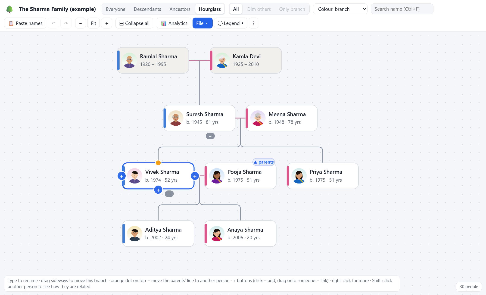
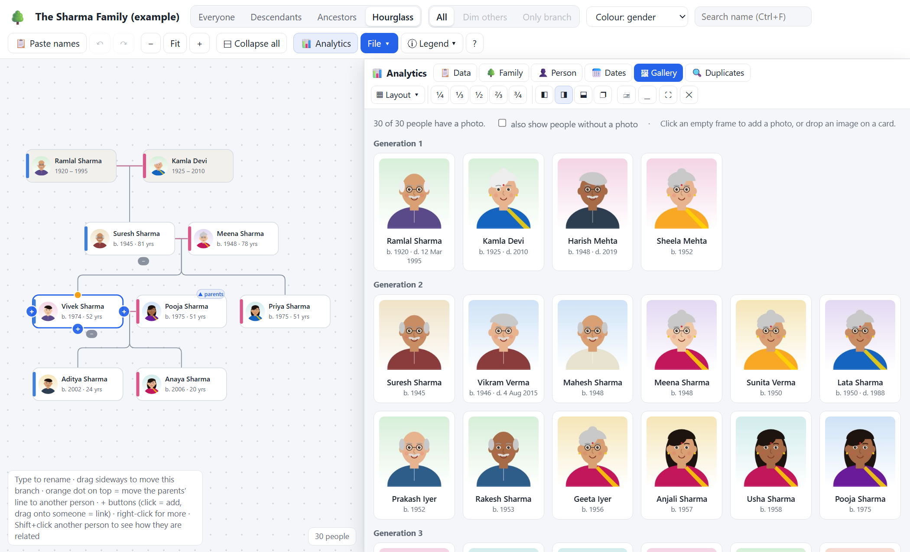
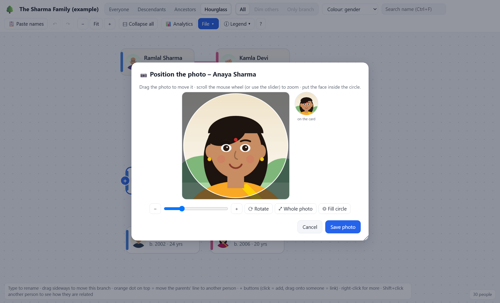
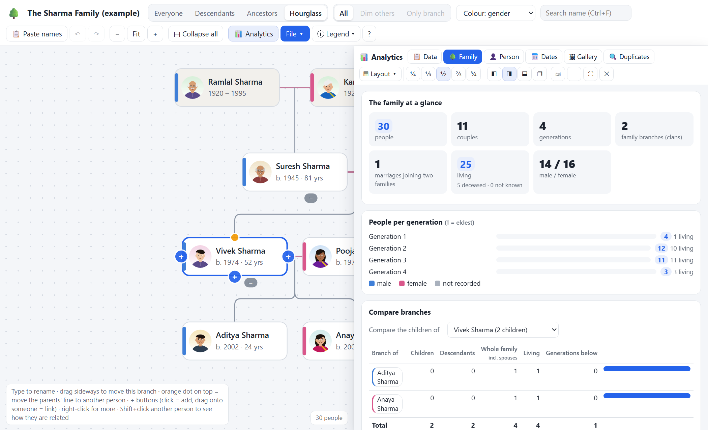
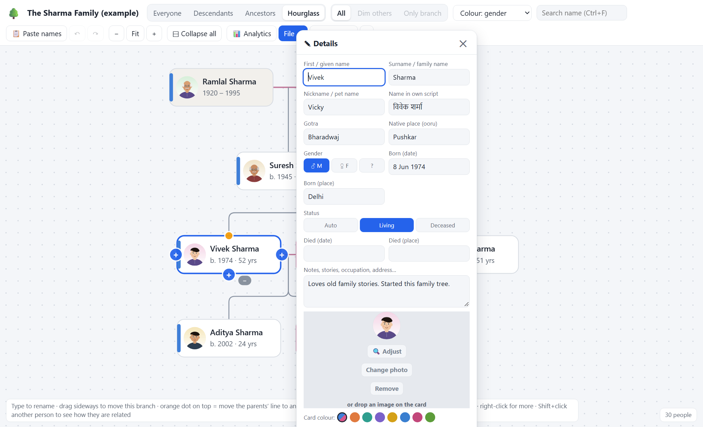
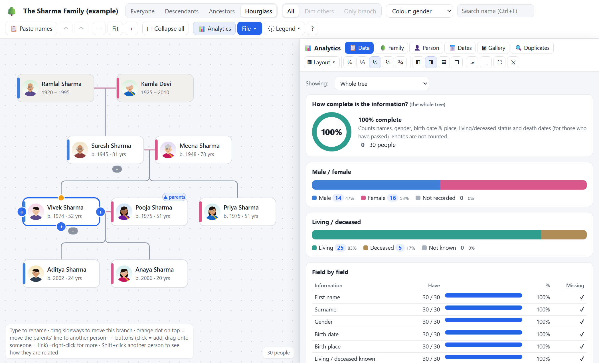
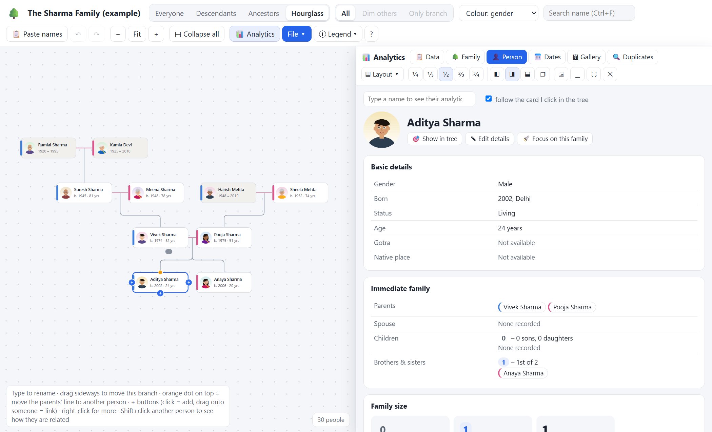

# 🌳 Family Tree Studio

### Your family's story, in one file. Private, free, and made for every generation.

Ask the youngest people at a family wedding how they are related to the uncle sitting next to them, and you will often get a shrug. Names fade and connections get forgotten. The people who remember who married whom, which village the family came from and which cousin moved abroad will not always be around to tell us.

**Family Tree Studio** is a simple way to write all of that down before it is lost. Then you share it with your whole family, so everyone can see how big the family really is and where they fit in.

- 🔒 **Completely private.** Your family's details never leave your computer. There is no sign-up, no server, no cloud and no ads.
- 💸 **Free forever.** No subscription and no "premium" version.
- 📄 **Just one file.** Download it, double-click it, and it opens in your browser. Nothing to install.
- ✈️ **Works offline.** No internet needed once you have the file.
- 🖱️ **Easy for everyone.** Click a card, type a name, done. Grandparents and grandchildren can both use it.

Example family. The portraits are illustrations, so add your own family's real photos.

---

## ⬇️ Download: pick your version

| | **Family Tree Studio** | **Family Tree Studio + Voice** |
|---|---|---|
| File | [`FamilyTree-NoVoice.html`](../../releases/latest) | [`FamilyTree.html`](../../releases/latest) |
| Size | about 510 KB (includes an example family) | about 560 KB (plus an optional ~600 MB voice engine) |
| Setup | **None.** Download and double-click. | Download, then optionally set up the offline voice engine |
| Build your tree by clicking and typing | ✅ | ✅ |
| Photos, analytics, Family Book, sharing | ✅ | ✅ |
| Build your tree by **speaking** | — | ✅ |
| Best for | **Most people**, and for sending to relatives | People who would rather talk than type |

👉 **Not sure? Take the one without voice.** It has every other feature, and you can switch later. Your saved family file works in both.

**Try it first without downloading:** [open it in your browser](https://rajeshm18.github.io/family-tree-studio/FamilyTree-NoVoice.html) It opens on an example family so you can explore, then click **"Start my own family tree"**. Anything you type stays in your own browser.

---

## 🌱 Getting started in 3 steps

1. **Download** the file from the [Releases page](../../releases/latest) (look under **Assets**). Save it anywhere, such as your Desktop.
2. **Double-click it.** It opens in Chrome or Edge (recommended). Click **"Add the first person"**, or **"Try the sample family"** to look around first.
3. **Keep your work safe** with **File → Save to file**. This makes a small `.json` file. Chrome and Edge keep saving to it automatically as you work.

Press **?** inside the app at any time to see every mouse and keyboard trick.

---

## 📸 See it in action

| | |
|---|---|
|  |  |
| **Everyone's photos, generation by generation** | **Zoom and move any photo so the face fits the circle** |
|  |  |
| **How big is our family? Analytics beside the tree** | **Gotra, native place and name in your own script** |
|  |  |
| **See what's missing at a glance** | **Everything about one person, and their immediate family** |

---

## ✨ What you can do

### Build the tree easily
- Hover over a person and click **+** to add a parent, partner, child or sibling. Type the name and press Enter.
- **Paste a list of names**, even an indented outline from WhatsApp or a notebook, and the tree builds itself.
- **Drag** cards and whole branches wherever you like. Reorder brothers and sisters.
- Record what matters to Indian families: **gotra**, **native place (ooru)** and **name in your own script**, along with birth, marriage and death dates, places, nicknames and notes.
- Views: **Everyone**, **Descendants**, **Ancestors** and **Hourglass**. You can colour the tree by branch, gender or generation.
- **Collapse and expand** branches, or everything at once. **Undo** anything.

### Photos that actually show the face
- **Drag a photo** onto a card from your computer, from Google Photos or from a web page, or copy a picture and press **Ctrl+V**.
- **Zoom, move and rotate** the photo so the face sits perfectly inside the circle.

### 📊 Family analytics
- **How big is our family?** Total people, generations, living and departed, men and women, and the largest families.
- **Missing details:** see exactly who has no birth date or photo, with "Not available" clearly shown, and a "fill these next" list.
- **Relationship finder:** pick any two people and see how they are related. The relationship name is shown in **English, Hindi, Telugu, Kannada and Tamil** (chacha, mama, athai, periyappa…).
- **Birthdays and anniversaries** coming up this week, plus a calendar for the whole year.
- **Possible duplicates** found and merged safely, and a **photo gallery** by generation.
- The analytics open beside the tree like a real window: ¼, ⅓, ½, ⅔ or ¾ of the screen, docked or floating, maximised or minimised.

### 📖 Share it with the whole family
- **Family Book:** a printable book (or PDF) with a cover, the full tree, a page for every family with photos, and an index. It makes a lovely gift for elders.
- **Share copy:** send the family one HTML file, either **view only** or **editable**. You can hide the details of living people for privacy.
- **Send a branch:** give a relative only their part of the tree to fill in.
- **Merge changes:** when relatives send their updated copy back, you see every change and tick the ones to keep. Nothing is overwritten without your OK.
- Import and export **GEDCOM**, the standard format used by Ancestry, MyHeritage, FamilySearch and others.

---

## 🎙️ About the voice version

With **Tell the Tree**, you build the tree by talking in plain sentences:

> *"Ramlal Sharma's father is Bhimrao and mother is Sita Rao."*
> *"Mahesh and Lata have two daughters, Aditi and Yukti."*
> *"It is not Sita Rao, it is Sita Sharma."* (it corrects itself)
> *"Undo."*

You can also **type** these sentences, and use the 🎙 button next to any name box to just say the name.

There are two ways to hear you:

- **Offline voice engine (recommended, fully private).** This uses OpenAI's open-source **Whisper** model running on your own PC, so your voice never leaves your computer. It is very accurate with Indian names and accents, and learns your family's spellings from the names already in your tree. A one-time setup of about 600 MB is needed: see **[VOICE-SETUP.md](VOICE-SETUP.md)**. Windows only.
- **Browser voice.** This works straight away in Chrome or Edge with no setup. It needs internet, and your browser's speech service (Google or Microsoft) hears the audio.

The voice engine is a separate program because it is far too big to put inside a single HTML file. That is why the version without voice exists: it stays small and needs nothing else.

---

## 🔐 Your privacy

- The app is one HTML file that runs entirely in your browser. **It makes no network requests** with your family data. There are no analytics, trackers or accounts.
- Your tree is kept in your browser's storage and in the `.json` file you save. Back up that file, for example to a pen drive or your own Google Drive.
- When you share a copy, *you* choose what goes in it: view-only or editable, with or without photos, and with living people's details hidden or not.

---

## ❓ Questions

**Does it work on a phone?**
It is designed for a computer with a mouse (Chrome or Edge). It opens on phones too, but a computer is much easier.

**Can two people work on the same tree?**
Yes. Each person edits their own copy and sends it back, and you use **File → Merge changes from a relative's copy** to combine them.

**I already have a tree on Ancestry or MyHeritage.**
Export it as GEDCOM there, then use **File → Open file** here.

**Is it really free?**
Yes. It was made for one family and shared so that every family can use it. If it helps you, tell a friend, or give the project a ⭐ on GitHub.

---

## 🛠️ For developers

The app is plain JavaScript with no frameworks and no dependencies.

- The source code is in `src/`.
- Run `node build.js` to produce both `FamilyTree.html` and `FamilyTree-NoVoice.html` from the same code. Parts of the page marked `<!--VOICE-->` are left out of the no-voice build.
- Run the tests with `node tests/<name>.test.js`.

Suggestions, bug reports and translations are welcome. Please open an issue.

## License

[MIT](LICENSE). Free to use, share and change.
